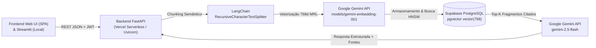

# AI Knowledge Assistant

Plataforma SaaS de Inteligência Artificial especializada em **conhecimento documental** e **Retrieval-Augmented Generation (RAG)**. O sistema combina uma interface corporativa moderna — construída sob direção visual inspirada na estética tecnológica **Specify** — com um pipeline determinístico de ingestão, indexação vetorial em **768 dimensões** no **Supabase (`pgvector`)**, orquestração via **LangChain** e síntese analítica fundamentada pelo **Google Gemini**.

---

## Sumário

1. [Visão Geral e Funcionalidades](#1-visão-geral-e-funcionalidades)
2. [Arquitetura do Sistema e Pipeline RAG](#2-arquitetura-do-sistema-e-pipeline-rag)
3. [Stack Tecnológica](#3-stack-tecnológica)
4. [Estrutura de Pastas](#4-estrutura-de-pastas)
5. [Demonstração e Screenshots](#5-demonstração-e-screenshots)
6. [Configuração do Supabase e pgvector](#6-configuração-do-supabase-e-pgvector)
7. [Instalação e Execução Local](#7-instalação-e-execução-local)
8. [Deploy Centralizado em Produção (Vercel)](#8-deploy-centralizado-em-produção-vercel)
9. [Segurança, Controle de Custos e Limitações Serverless](#9-segurança-controle-de-custos-e-limitações-serverless)
10. [Testes Automatizados](#10-testes-automatizados)

---

## 1. Visão Geral e Funcionalidades

O **AI Knowledge Assistant** resolve o desafio corporativo de consultar acervos técnicos (`.pdf`, `.docx`, `.md`, `.txt`) com **rastreabilidade estrita de fontes** e **prevenção de alucinações**:

- **Página Inicial Executiva**: Hero escuro (`#151718`) com headline em gradiente violeta (`#624de3` → `#8d4af7`), indicadores ao vivo e representação visual das 5 etapas do pipeline RAG.
- **Dashboard Operacional**: Monitoramento em tempo real de documentos indexados, fragmentos vetoriais (`768d`), histórico de conversas, volume de armazenamento e status de conectividade dos serviços.
- **Biblioteca Documental**: Upload múltiplo de arquivos com higienização de nomes, extração textual estruturada, identificação de formato (`PDF`, `DOCX`, `MD`, `TXT`), inspeção individual de fragmentos vetoriais, reindexação atômica e exclusão.
- **Assistente RAG com Citações e Abstinência**:
  - Interface de chat limpa com histórico persistente de conversas e filtro opcional de escopo documental.
  - Respostas estruturadas geradas pelo `gemini-2.5-flash` com citações inline no formato `[Fonte: arquivo | Trecho #N]`.
  - **Painel de Referências Documentais** exibindo os trechos exatos recuperados e o percentual de similaridade semântica.
  - **Abstinência Estrita**: Caso nenhum fragmento atinja o limiar mínimo de similaridade (`RAG_MIN_SIMILARITY_THRESHOLD`), o assistente abstém-se de responder com suposições e informa a ausência de evidências suficientes.
- **Autenticação e Isolamento Multi-usuário**: Autenticação via JWT (`HMAC-SHA256`) integrada ao Supabase Auth e isolamento de documentos/conversas por `user_id` + políticas de Row Level Security (RLS).

---

## 2. Arquitetura do Sistema e Pipeline RAG



### Etapas do Pipeline RAG
1. **Ingestão Documental**: Validação de extensão/tamanho e extração de texto (`pypdf` para PDF, `python-docx` para DOCX e decodificação UTF-8/Latin-1 para Markdown e TXT).
2. **Fragmentação Semântica (Chunking)**: Uso do `RecursiveCharacterTextSplitter` do LangChain (`CHUNK_SIZE=900`, `CHUNK_OVERLAP=150`), respeitando o teto de `MAX_CHUNKS_PER_DOCUMENT=250`.
3. **Vetorização Unificada (768 Dimensões)**: Documentos (`task_type="retrieval_document"`) e perguntas (`task_type="retrieval_query"`) utilizam exatamente o mesmo modelo `models/gemini-embedding-001` com redução Matryoshka (`output_dimensionality=768`) e normalização L2.
4. **Busca Semântica (`pgvector`)**: Execução da função RPC `match_document_chunks` sobre índice `HNSW` (`vector_cosine_ops`) aplicando filtro de similaridade mínima (`RAG_MIN_SIMILARITY_THRESHOLD=0.30`).
5. **Síntese Fundamentada**: Geração via `gemini-2.5-flash` restrita exclusivamente aos fragmentos recuperados, ou acionamento imediato do guardrail de abstinência.

---

## 3. Stack Tecnológica

| Camada | Tecnologia | Função no Projeto |
| :--- | :--- | :--- |
| **Frontend Web (Vercel)** | HTML5 + CSS Custom Properties (`Inter`) + Vanilla JS | Interface SaaS unificada servida diretamente na raiz `/` da Vercel |
| **Frontend Local** | Streamlit + CSS Custom Properties (`Inter`) | Interface complementar para execução local interativa |
| **Backend API** | FastAPI + Uvicorn + Pydantic v2 | API RESTful, validação de contratos, autenticação e segurança |
| **Orquestração RAG** | LangChain (`langchain-google-genai`, `langchain-text-splitters`) | Segmentação contextual, templates de prompt e cadeia RAG |
| **LLM (Geração)** | Google Gemini API (`gemini-2.5-flash`) | Síntese executiva estruturada com aterramento documental |
| **Embeddings** | Google Gemini API (`models/gemini-embedding-001`) | Vetorização semântica em `768` dimensões (MRL) |
| **Banco Vetorial** | Supabase PostgreSQL + `pgvector` | Persistência relacional, vetores `vector(768)`, índice HNSW e RLS |
| **Segurança** | JWT (`HS256`) + `PBKDF2-HMAC-SHA256` + Rate Limiter | Autenticação, proteção de rotas e controle de custos de API |

---

## 4. Estrutura de Pastas

```text
Assistant/
├── .streamlit/
│   └── config.toml                # Configuração de tema e servidor do Streamlit (uso local)
├── api/
│   └── index.py                   # Entrypoint ASGI para deploy Serverless centralizado na Vercel
├── backend/
│   ├── __init__.py
│   ├── config.py                  # Configurações centralizadas via variáveis de ambiente
│   ├── database.py                # Repositório Supabase pgvector (768d) + fallback SQLite local
│   ├── main.py                    # Aplicação FastAPI, Web UI em `/` e rotas REST `/api/*`
│   ├── rag_pipeline.py            # Extração, chunking LangChain, embeddings Gemini e síntese RAG
│   ├── schemas.py                 # Modelos Pydantic v2 de requisição e resposta
│   ├── security.py                # JWT, hashing de senhas, Rate Limiting e sanitização
│   └── web_ui.html                # Aplicação Web SaaS completa (Specify Design System) servida na Vercel
├── frontend/
│   ├── styles/
│   │   └── specify_theme.css      # Design System CSS oficial (Paleta, Tipografia Inter, Grid 8px)
│   ├── api_client.py              # Cliente HTTP integrado ao backend FastAPI
│   ├── app.py                     # Aplicação Streamlit (Início, Dashboard, Biblioteca, Assistente)
│   └── requirements.txt           # Dependências completas para execução local com Streamlit
├── supabase/
│   └── schema.sql                 # Script SQL completo (tabelas, vector(768), HNSW, RPC e RLS)
├── tests/
│   └── test_gemini_rag.py         # Suíte de testes automatizados de arquitetura, RAG e segurança
├── .env.example                   # Template de variáveis de ambiente (sem chaves secretas)
├── .gitignore                     # Regras de exclusão do Git (proteção de .env e bancos locais)
├── .vercelignore                  # Exclusão de arquivos de testes/bancos locais no bundle da Vercel
├── DESIGN_SYSTEM.md               # Documentação da Direção Visual Oficial
├── README.md                      # Documentação principal do projeto
├── requirements.txt               # Dependências enxutas de Produção (compatível com Vercel)
├── run_assistant.ps1              # Script PowerShell para inicialização local automatizada
└── vercel.json                    # Configuração de rotas e funções Serverless da Vercel
```

---

## 5. Demonstração e Screenshots

### Links do Ambiente Publicado (Centralizado na Vercel)
- **Aplicação Web SaaS Completa (Vercel)**: [https://ai-knowledge-assistant-ragg.vercel.app/](https://ai-knowledge-assistant-ragg.vercel.app/)
- **Backend API & Swagger Docs (Vercel)**: [https://ai-knowledge-assistant-ragg.vercel.app/docs](https://ai-knowledge-assistant-ragg.vercel.app/docs)
- **Health Check do Pipeline RAG (Vercel)**: [https://ai-knowledge-assistant-ragg.vercel.app/api/health](https://ai-knowledge-assistant-ragg.vercel.app/api/health)

### Capturas de Tela
- **Página Inicial (Hero & Pipeline RAG)**:
  `<!-- Adicione a imagem em docs/screenshots/home.png e descomente:  -->`
- **Dashboard Operacional**:
  `<!-- Adicione a imagem em docs/screenshots/dashboard.png e descomente:  -->`
- **Biblioteca Documental**:
  `<!-- Adicione a imagem em docs/screenshots/library.png e descomente:  -->`
- **Assistente RAG & Painel de Referências**:
  `<!-- Adicione a imagem em docs/screenshots/assistant.png e descomente:  -->`

---

## 6. Configuração do Supabase e pgvector

1. Crie um novo projeto no [Supabase](https://supabase.com/).
2. No painel lateral do Supabase, abra o **SQL Editor** e execute integralmente o conteúdo do arquivo [`supabase/schema.sql`](./supabase/schema.sql).
   - O script habilita a extensão `vector` (`pgvector`), cria as tabelas `documents`, `document_chunks` (com coluna `embedding vector(768)`), `conversations` e `messages`, configura o índice `HNSW`, cria a função RPC `match_document_chunks` e ativa as políticas de **Row Level Security (RLS)**.
3. Em **Project Settings > API**, copie:
   - `Project URL` → `SUPABASE_URL`
   - `anon public` key → `SUPABASE_KEY`
   - `service_role` secret key → `SUPABASE_SERVICE_ROLE_KEY` (utilizada exclusivamente no backend).

---

## 7. Instalação e Execução Local

### Pré-requisitos
- Python **3.11+**
- Chave de API do Google Gemini ([Google AI Studio](https://aistudio.google.com/))

### Opção A: Inicialização Rápida (Windows PowerShell)
```powershell
.\run_assistant.ps1
```

### Opção B: Passo a Passo Manual
1. **Crie e ative o ambiente virtual**:
   ```powershell
   python -m venv .venv
   .\.venv\Scripts\Activate.ps1
   ```
2. **Instale as dependências completas (Backend + Frontend)**:
   ```powershell
   pip install -r frontend/requirements.txt
   ```
3. **Configure o arquivo `.env`**:
   ```powershell
   Copy-Item .env.example .env
   ```
   Preencha `GEMINI_API_KEY`, `SUPABASE_URL`, `SUPABASE_KEY`, `SUPABASE_SERVICE_ROLE_KEY` e `JWT_SECRET_KEY`.
   > Em modo de desenvolvimento local (`APP_ENV=development`), caso o Supabase ainda não esteja configurado, o sistema utiliza automaticamente um espelho vetorial local em `data/knowledge_store.db` (`768` dimensões).
4. **Inicie o Backend FastAPI (Terminal 1)**:
   ```powershell
   uvicorn backend.main:app --reload --port 8000
   ```
5. **Inicie o Frontend Streamlit (Terminal 2)**:
   ```powershell
   streamlit run frontend/app.py
   ```

---

## 8. Deploy Centralizado em Produção (Vercel)

O projeto possui **deploy 100% centralizado na Vercel**: o **Backend FastAPI** e a **Interface Web SaaS completa** (`backend/web_ui.html`, construída sob o Design System Specify) são servidos na mesma aplicação Serverless em `https://ai-knowledge-assistant-ragg.vercel.app/`, eliminando a dependência de plataformas secundárias.

### Passo a Passo para Deploy na Vercel
1. Importe o repositório GitHub na [Vercel](https://vercel.com/).
2. A Vercel detectará automaticamente o arquivo [`vercel.json`](./vercel.json) e o entrypoint [`api/index.py`](./api/index.py), instalando as dependências enxutas do [`requirements.txt`](./requirements.txt) da raiz e servindo tanto a interface visual em `/` quanto as rotas REST em `/api/*` e `/docs`.
3. Em **Project Settings > Environment Variables**, configure:
   - `APP_ENV=production`
   - `ENABLE_SEED_DOCUMENTS=true`
   - `DEMO_AUTO_LOGIN=true`
   - `GEMINI_API_KEY=<sua-chave-gemini>`
   - `GEMINI_LLM_MODEL=gemini-2.5-flash`
   - `GEMINI_EMBEDDING_MODEL=models/gemini-embedding-001`
   - `GEMINI_EMBEDDING_DIMENSION=768`
   - `SUPABASE_URL=<sua-url-supabase>`
   - `SUPABASE_KEY=<sua-anon-key>`
   - `SUPABASE_SERVICE_ROLE_KEY=<sua-service-role-key>`
   - `JWT_SECRET_KEY=<segredo-forte-aleatorio>`
   - `CORS_ALLOWED_ORIGINS=https://ai-knowledge-assistant-ragg.vercel.app`
   - `MAX_UPLOAD_SIZE_MB=4`
4. Realize o deploy e acesse:
   - **Interface Web Completa**: `https://<seu-app>.vercel.app/`
   - **Documentação Interativa (Swagger)**: `https://<seu-app>.vercel.app/docs`
   - **Diagnóstico de Saúde**: `https://<seu-app>.vercel.app/api/health`

---

## 9. Segurança, Controle de Custos e Limitações Serverless

- **Isolamento da Chave Gemini**: `GEMINI_API_KEY` é lida exclusivamente pelo backend (`backend/config.py`) e passa por sanitização automática de logs/erros (`sanitize_error_message` em `backend/security.py`).
- **Controle de Custos e Rate Limiting**:
  - Limite de requisições por minuto (`RATE_LIMIT_REQUESTS_PER_MINUTE=30`).
  - Limite máximo de caracteres por pergunta (`RAG_MAX_QUESTION_CHARS=2000`).
  - Limite de fragmentos gerados por documento (`MAX_CHUNKS_PER_DOCUMENT=250`).
  - Teto de tokens de saída (`GEMINI_MAX_OUTPUT_TOKENS=2048`).
- **Limitações de Funções Serverless (Vercel)**:
  - **Filesystem Somente-Leitura**: Na Vercel (`/var/task`), a escrita em disco local só é permitida em `/tmp`. O `backend/config.py` redireciona automaticamente diretórios temporários para `/tmp` quando detecta `VERCEL=1`, exigindo que o **Supabase** esteja configurado para persistência definitiva entre execuções.
  - **Tamanho Máximo de Upload HTTP**: Funções Serverless na Vercel possuem limite físico de payload de **4,5 MB** por requisição (`MAX_UPLOAD_SIZE_MB=4`). Para arquivos maiores em produção, utilize upload direto para o Supabase Storage.
  - **Tempo de Execução (Timeout)**: Configurado em `60s` no `vercel.json`.

---

## 10. Testes Automatizados

Para executar a suíte de validação de modelos, dimensões vetoriais (`768d`), isolamento de segurança, citações, abstinência e rate limiting:

```powershell
python -m unittest discover -s tests -v
```
